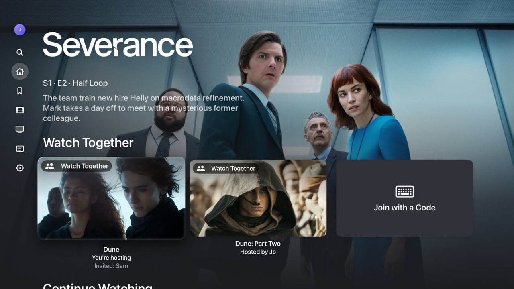
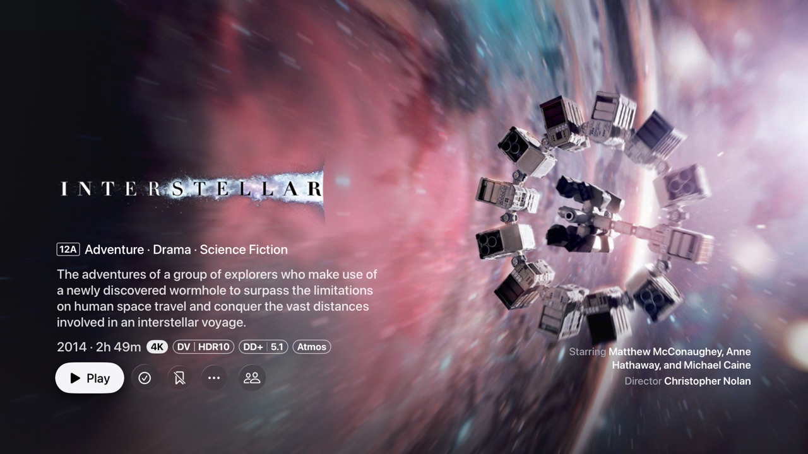
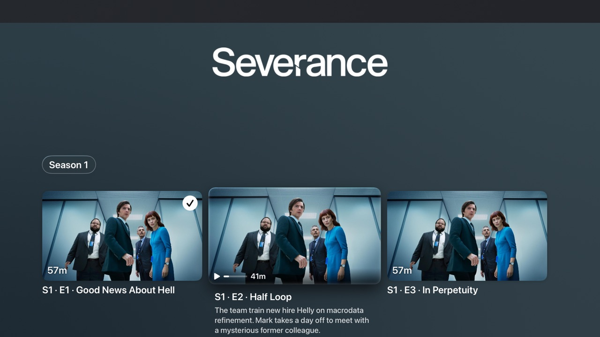
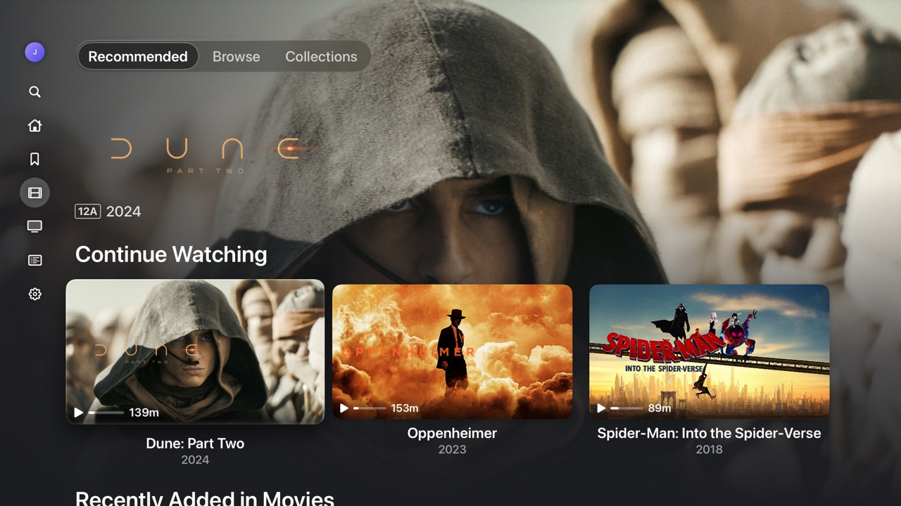
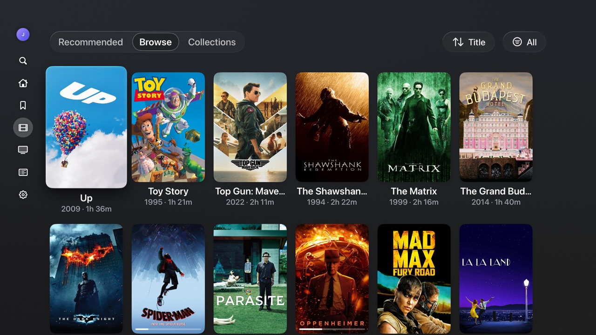
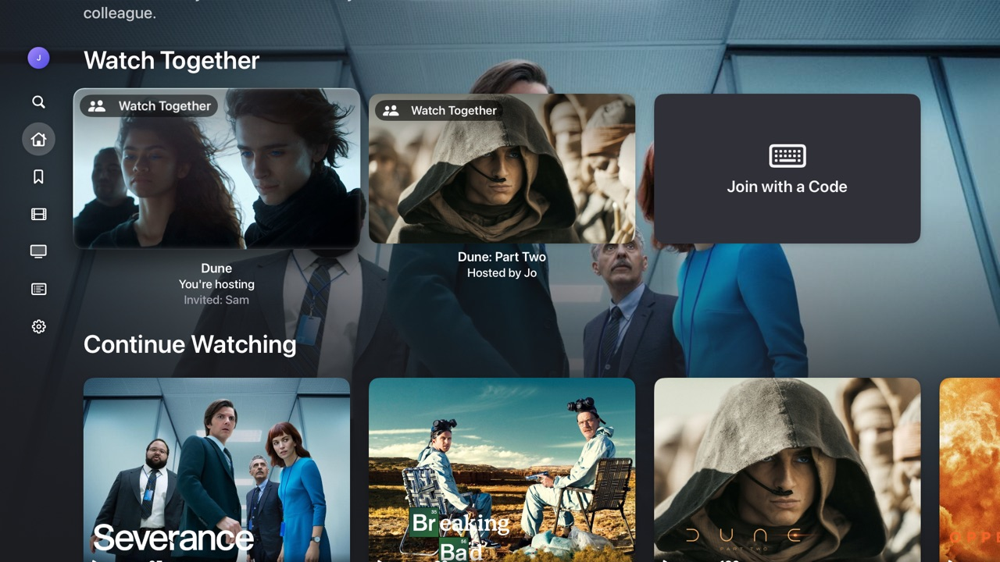
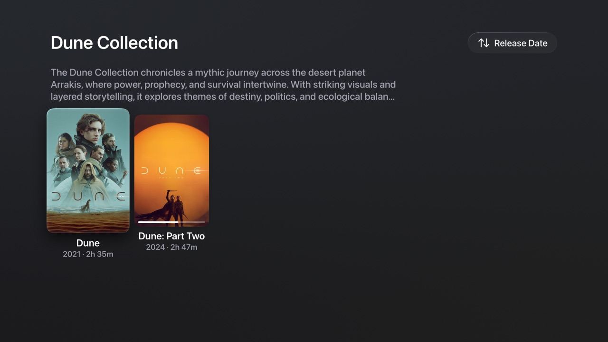
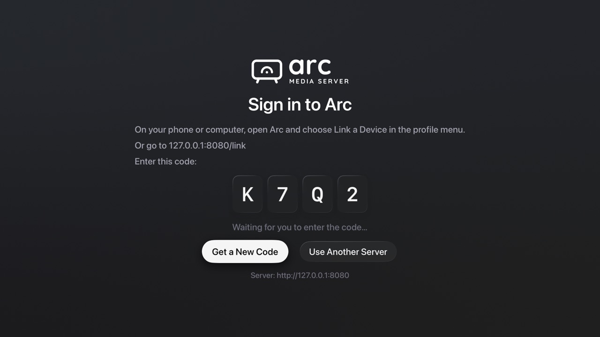
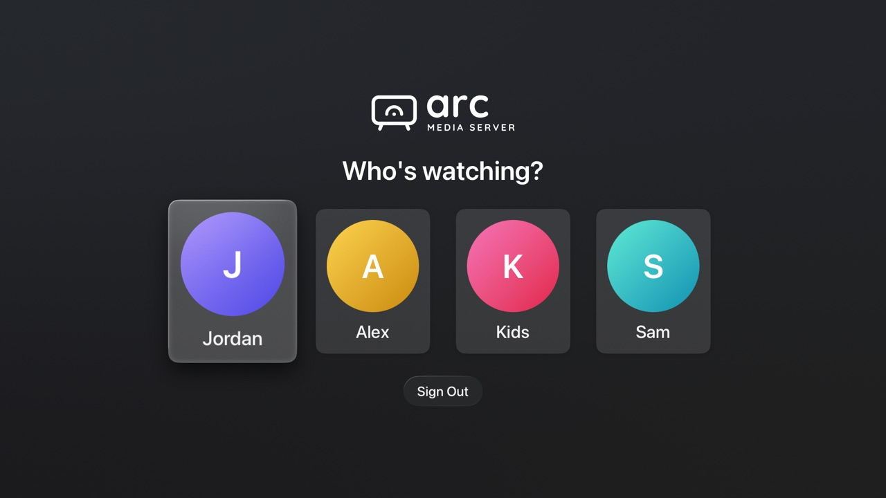
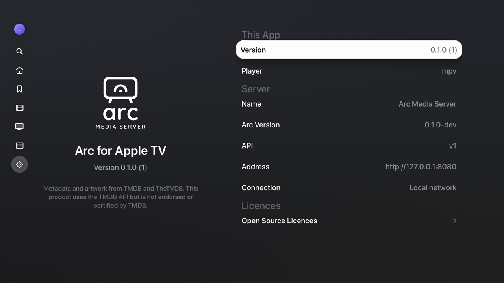

<p align="center">
  <picture>
    <source media="(prefers-color-scheme: dark)" srcset="docs/brand/arc-logo-stacked-white.svg">
    
  </picture>
</p>

<p align="center">
  <strong>Arc for Apple TV: your Arc library on tvOS, made for the Siri Remote.</strong>
</p>

<p align="center">
  
  
  
  
  
</p>

<p align="center">
  
</p>

## What is Arc for Apple TV?

The Apple TV app for [Arc Media Server](https://github.com/arc-media-server/arc-media-server). If
you've used other media servers, it's the same idea: your films and shows live on your own server at
home, and this app shows them on the TV. It's a native app in Swift and SwiftUI. It feels at home
on tvOS: the focus engine, Liquid Glass, Top Shelf, Control Center's Now Playing and Match
Content all work as they do in Apple's own apps.

Everything comes from your Arc server through its stable `/api/v1`, so your watch history, resume
points and settings are the same as on every other Arc app. An iPhone and iPad app (early, see
[below](#iphone-and-ipad)) lives in this same repository, sharing ArcKit (the API client, models
and playback logic), the player and the data behind the screens.

> **Alpha software, not yet on the App Store or TestFlight.** You build it yourself with Xcode
> (below). Its screens are checked in the tvOS simulator on every build. Playback, HDR, Dolby
> Vision and audio formats depend on your Apple TV, TV and receiver, and haven't been checked on
> every combination. See [what's changed](docs/changes/).

<table>
  <tr>
    <td width="50%"></td>
    <td width="50%"></td>
  </tr>
  <tr>
    <td width="50%"></td>
    <td width="50%"></td>
  </tr>
  <tr>
    <td width="50%"></td>
    <td width="50%"></td>
  </tr>
</table>

<sub>Artwork and details from TMDB. Films and shows belong to their owners; Arc doesn't include any media.</sub>

## What it does

**🏠 Artwork-led Home.** Continue Watching, Up Next and your libraries' rows, laid out as you
arranged them in Arc, with the focused title's artwork filling the screen as you move. Arc's
Continue Watching also appears in the Top Shelf.

**🎬 Title pages in Arc's design.** Play or Resume, Watched and Watchlist; cast, extras, More Like
This and collections; seasons and episodes in the order you chose in Arc, including episodes that
order doesn't place. Shuffle a show or a season. Pick a version (4K, a Director's Cut) when a
title has more than one.

**📚 Libraries you can browse.** Recommended rows, a Browse grid with Sort, Filter and an A–Z bar,
Collections and folders for home videos, playlists, and pages for people and collections. Search
finds titles, people and collections.

**▶️ A full player.** mpv plays almost every file as it is (MKV, HEVC, AV1, TrueHD, DTS, Dolby
Vision, HDR10+), so Arc converts only for bandwidth away from home or the truly unusual. The controls match Arc's other players: the
timeline with thumbnails and chapters, Skip Intro, Recap and Credits, Up Next, audio and subtitle
tracks with Subtitle Timing, quality and versions, and Info, Chapters, Cast and Episodes cards.
Control Center and an iPhone's remote work as with Apple's apps.

**🔊 Your home cinema.** Match Content switches the TV to the file's dynamic range and frame rate,
and the app tells Arc what your Apple TV plays, so files play as they are where possible.

**🍿 Watch Together, play queues and more.** Watch in sync with others in a Watch Together room;
Play Next and Add to Queue; theme music on title pages; pre-roll videos before a film.

**👨‍👩‍👧 Made for a household.** Profiles with PINs, Hide Spoilers, Auto-Play, Skip Intros and
audio and subtitle preferences that follow you to every Arc app.

**🔐 Signs in with a code.** The app finds Arc on your network (or you type its address), then
you approve a short code from Arc on your phone or computer. The sign-in is kept in the Keychain,
and appears in Arc's Settings → Devices, where it can be signed out.

<table>
  <tr>
    <td width="33%"></td>
    <td width="33%"></td>
    <td width="33%"></td>
  </tr>
</table>

## Installing

You need an Apple TV HD or 4K on tvOS 18 or newer, an Arc server you can reach from it, and a Mac
with Xcode 16 or newer. The app isn't on the App Store or TestFlight yet, so you build it onto your
Apple TV yourself.

1. **Get the project:** clone this repository, then `brew install xcodegen` and run
   `xcodegen generate` in it. That writes `Arc.xcodeproj`.
2. **Pair the Apple TV with Xcode:** on the Apple TV, Settings → Remotes and Devices → Remote App
   and Devices; in Xcode, Window → Devices and Simulators, choose the Apple TV and enter the code
   it shows. The Mac and Apple TV need to be on the same network.
3. **Sign and run:** open `Arc.xcodeproj`, choose the **ArcTV** target → Signing & Capabilities,
   pick your team (a free Apple Account works) and, if Xcode asks, change the bundle identifier to
   one of your own. Choose your Apple TV as the destination and press Run.
4. **Open Arc** on the Apple TV. Choose your server from the list, or type its address as you'd
   type it in a browser at home (port 8099 is assumed unless you type another;
   `https://arc.example.com` works for remote access). Then open Arc on your phone or computer,
   choose **Link a Device** in the profile menu (or go to `<server>/link`) and enter the code shown.

With a free Apple Account the app stops opening after 7 days; run it from Xcode again to renew
it. A paid Apple Developer membership makes that a year.

### iPhone and iPad

The **ArcMobile** target is the same app for iPhone and iPad (iOS 18 or newer), early and not yet
checked on a real device. It follows iOS's own conventions (a tab bar for Home, Libraries and
Search that becomes a sidebar on iPad, pages that push and swipe back, touch-and-hold menus on
titles, Settings as a sheet, a full-screen touch player) in Arc's dark, colourless look, with the
same words as the other Arc apps. Build it the same way: choose the **ArcMobile** target and your
iPhone or iPad as the destination (turn on Developer Mode on the device when iOS asks). Signing in
works as on the TV: a code to enter in Link a Device, or **Open Link a Device** on the phone itself
if you're signed in to Arc's web app there.

## For developers

You need a Mac with Xcode 16 or newer (Xcode 26 for tvOS 26's Liquid Glass) and XcodeGen.
`project.yml` is the project; `Arc.xcodeproj` is generated from it and isn't kept in git.

```sh
swift test --package-path ArcKit     # ArcKit's tests (on Linux too)
xcodegen generate                    # writes Arc.xcodeproj
open Arc.xcodeproj                   # run the ArcTV scheme in the Apple TV simulator
```

### Builds and screenshots on GitHub

GitHub's **Build** workflow (Actions → Build → Run workflow, or a push whose commit message
contains `[build]`) runs ArcKit's tests and builds the Apple TV and iPhone/iPad apps. It then
walks the Apple TV app in the tvOS simulator with the remote's buttons
(`UITests/ArcTVUITests/WalkThrough.swift`), and the iPhone app in an iPhone simulator by touch
(`UITests/ArcMobileUITests/WalkThrough.swift`), against a stand-in Arc (`UITests/StandIn/serve.py`), which answers from responses
recorded from Arc's shared screenshot library. Every screen's screenshot is attached to the run and copied as small JPEGs to
the `ci-screenshots` branch (`runs/<run id>/`).

The pictures in this README come from that walk-through: simulator captures, not a real Apple TV.
The player isn't pictured, because the stand-in plays a test clip rather than a film.

### Testing against a real Arc

`LiveServerTests` (in ArcKit) drives the API client through a visit against a running Arc: a TV
sign-in code, PINs, Home rows, a show's seasons, a direct play and a converted stream, and
progress. It's skipped unless pointed at a server. Use a scratch Arc, never a real one (see the
server's `docs/DEVELOPING.md`).

### Layout

```
ArcKit/          Swift package (Foundation only): the /api/v1 client, models, Home rows,
                 playback clock, play queues, Watch Together; with tests
ArcTV/App/       entry point, AppModel, Keychain, Theme (all colours), L() for strings
ArcTV/Screens/   one view per screen: server, sign-in, profiles, Home, libraries, title pages,
                 person, search, Settings
ArcTV/Player/    PlaybackEngine with the mpv and Apple engines, the player's screen and controls
ArcTV/Components/  shared cards, artwork, grids and Home's hero rows
ArcTV/Together/  Watch Together's rooms, lobby and invites
ArcTV/Shared/    what the app and the Top Shelf share (the sign-in, through an app group)
ArcTV/Models/    the data behind screens, shared with iPhone and iPad (Home's rows, routes)
ArcTopShelf/     the Top Shelf extension
ArcMobile/       the iPhone and iPad app's entry, screens, cards and touch player
ArcTV/Resources/en.lproj/Localizable.strings   every word the app shows
UITests/         the simulator walk-through and the stand-in Arc
```

The app logs with `os.Logger` (subsystem `org.arcmediaserver.apple`, category `Arc`); see it in
Console.app with the Apple TV connected. Each change is described in [`docs/changes/`](docs/changes/).

## Licence

AGPL-3.0-only, copyright "The Arc Media Server Authors", with an additional permission for
distribution through the App Store and TestFlight. See [LICENSE](LICENSE) and
[LICENSE-EXCEPTION.md](LICENSE-EXCEPTION.md).

The film and TV artwork in the screenshots belongs to its owners and comes from
[TMDB](https://www.themoviedb.org). This product uses the TMDB API but is not endorsed or
certified by TMDB.
